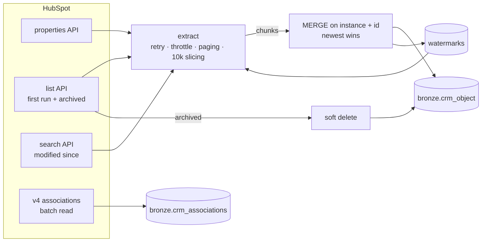

# HubSpot to Delta Lake ingestion

[](https://github.com/suriyalakshmi-chandrasekar/hubspot-to-delta-ingestion/actions/workflows/ci.yml)
   

Land HubSpot CRM data (companies, contacts, deals, any object) in Delta bronze tables: **incremental**, **safe under rate limits**, across **several HubSpot instances**, with **deletes** and **associations**.

It includes a **fake HubSpot API**, so you can run everything (demo and tests) without a HubSpot account.

## What makes CRM ingestion hard, and how this handles it

| Problem | How it's handled |
|---|---|
| **429 rate limits** during big loads | Retries that honour `Retry-After`, exponential backoff with jitter, plus a client-side throttle so you hit the limit less often. 5xx and connection errors are retried too. |
| The **search API stops at 10,000 results** | Time-window slicing: when a query reaches the cap, a new one starts from the last modified timestamp seen. Backfills of any size keep working. |
| **New custom properties** appear all the time | Property discovery on every run. New fields become new bronze columns automatically (Delta schema evolution). Noisy calculated fields (`hs_date_entered_*`, `hs_time_in_*`) are skipped. |
| Records **deleted** in HubSpot stay in your lake | Archived records are fetched each run and **soft-deleted** (`archived = true`, `archived_at`), so history is kept. |
| **Associations** change without the record changing | Links are refreshed for every changed record, replacing the old set, so removed links disappear too. |
| **Several HubSpot instances** (business units, regions) | One table per object with an `instance` column. Each instance has its own token and watermark. `(instance, object)` pairs run in parallel. |
| Late or repeated records | A small overlap is re-read each run, the newest copy per key wins in the MERGE, and an older copy never overwrites a newer one. Watermarks only move forward. |
| **Contacts** use `lastmodifieddate`; other objects use `hs_lastmodifieddate` | Handled per object type. |

## How it works



**Tables created**

| Table | Contents |
|---|---|
| `bronze.crm_<object>` | One row per record per instance: `instance`, `id`, `created_at`, `updated_at`, `archived`, `archived_at`, and one `p_<property>` string column per HubSpot property |
| `bronze.crm_associations` | `instance`, `from_type`, `from_id`, `to_type`, `to_id`, `type_id`, `category`, `label` |
| `bronze._crm_watermarks` | Last modified timestamp loaded, per instance and object |

## Configure

```yaml
instances:
  - name: sales
    token_env: HUBSPOT_TOKEN_SALES        # private-app token, from env or a secret scope
  - name: partners
    token_env: HUBSPOT_TOKEN_PARTNERS
objects:
  - name: companies                       # no list: discover all properties
  - name: contacts
    associations: [companies]
  - name: deals
    properties: [dealname, amount, dealstage, closedate]
    associations: [companies]
overlap_minutes: 5
max_workers: 4
requests_per_second: 8
```

## Run it

```bash
pip install -e ".[spark,dev]"
python examples/demo.py          # fake API, day 1 full load + day 2 incremental
python -m crmingest.fake_hubspot # or run the fake API on its own (port 8765)
```

On Databricks:

```bash
databricks secrets create-scope crm
databricks secrets put-secret crm HUBSPOT_TOKEN_SALES
databricks bundle deploy -t dev
databricks bundle run crm_to_bronze -t dev
```

## Tests

```bash
pytest -v
```

- **Client tests** (no Spark, against the fake API): paging, 429 retries, giving up on persistent 5xx, bad token, modified-since search, **slicing past the result cap**, archived records, batch associations.
- **Integration tests** (local Spark and Delta, run in CI): a two-instance full load, a day-2 incremental run (updates, new records, soft deletes, new association links), re-runs with no changes, and watermarks that never move backwards.

## Layout

```
src/crmingest/
  client.py        HubSpot client: retry, throttle, paging, search slicing, v4 associations
  extract.py       pure helpers: search body, timestamps, property selection, flattening
  pipeline.py      Spark/Delta: MERGE, soft deletes, associations, watermarks, parallel runs
  config.py        YAML config
  fake_hubspot.py  fake HubSpot API (standard library only)
config/ingest.yaml
databricks.yml + databricks/ingest.py   hourly job, tokens from a secret scope
```

## Timeline

I built this pattern in production in **2024–2025**: two CRM instances, 11+ object types, and up to **500M+ historical records** from a single endpoint. Parallel batches and consolidating per-instance pipelines into one framework cut the historical load from **~16 hours to ~2 hours** and processing cost by about **50%**. This repository is a **generic open-source rebuild (Nov 2026)**, written from scratch with synthetic data and no client code.

## Author

**Suriyalakshmi Chandrasekar**: Technical Lead, Data Engineering · Databricks Certified Data Engineer Professional
[LinkedIn](https://www.linkedin.com/in/suriyalakshmi-chandrasekar) · [GitHub](https://github.com/suriyalakshmi-chandrasekar)

Not affiliated with HubSpot. MIT licensed.
